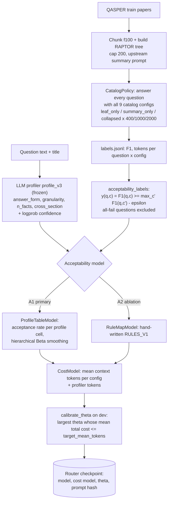
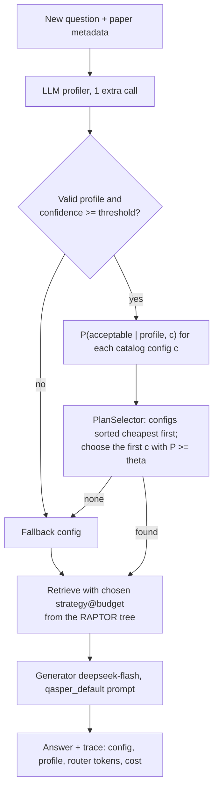
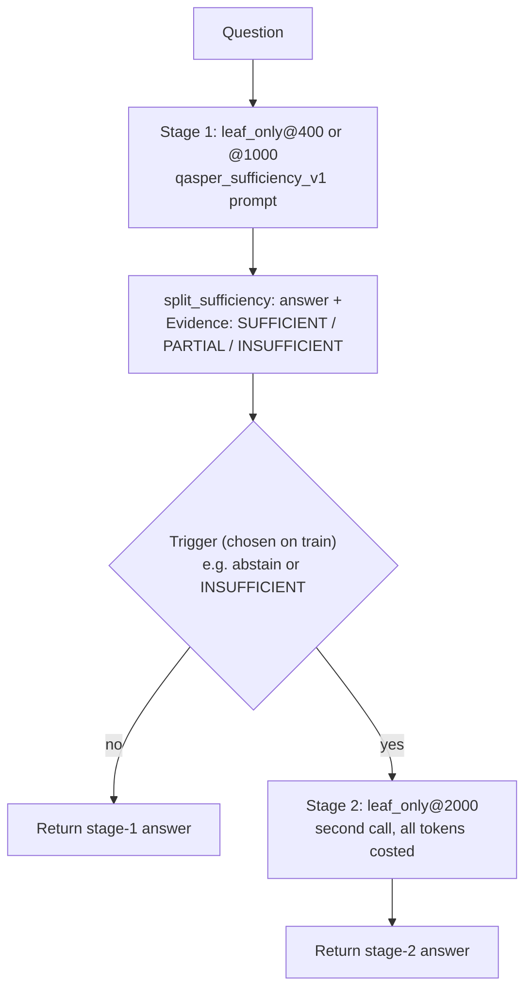

# Query-time optimizer: workflow and related literature

Written 2026-11-10. The diagrams describe the implemented code: `src/adaptive_raptor/optimizer/`, `policy.py`, `profiling.py`, `scripts/analyze_cascade.py`. Results come from NOTES.md.

## 1. Offline: label collection and router training (train split)

## 2. Query time: router (A1/A2)

**Result (dev, n=918).** A1 scored −4.0 F1 vs a leaf mix at matched cost and −5.2 vs original RAPTOR. A2 was also worse. Across 61 offline routing candidates built from profile, retrieval-score and question features, none was significantly better than the matched mix.

## 3. Query time: sufficiency cascade (tested, stopped)

**Result (dev).** Against a fixed mix at matched USD using the same new prompt, the cascade scored −0.25 F1 [−1.3, +0.6]. Its earlier "gain" came from the prompt change; a fixed leaf_only@2000 with the new prompt gains +1.5 F1 [+0.1, +2.9] on its own. Per the agreed stop rule, the cascade is stopped.

## 4. Does published work support this approach?

**Partly. Published work reports gains for per-query configuration choice, but in settings that differ from ours in ways that matter.**

| Paper | What is adapted, and which signal | Reported effect | How it relates to our result |
|---|---|---|---|
| **METIS** (Ray et al., SOSP 2025) [1] | An LLM profiler rates each query on 4 dimensions. The profile prunes the RAG configuration space, then a scheduler picks a config | 12–15% higher quality and 2.5–3× lower delay than any fixed config | **Direct basis of our A1/A2** (the profiler docstring cites it). Their configuration space includes the synthesis method and number of chunks, across several datasets. Our space is 9 leaf/summary/collapsed budgets on one-paper QASPER QA, where the configs differ far less, and the same idea did not reproduce |
| **Adaptive-RAG** (Jeong et al., NAACL 2024) [2] | A small T5 classifier predicts query complexity and routes to no retrieval, single-step or multi-step retrieval. Labels come from model outcomes | Better accuracy/efficiency than fixed strategies on single- and multi-hop QA | Its strategies differ in kind (0, 1 or many retrieval rounds). Ours differ only in context size and granularity over the same paper, so a complexity signal has much less to work with |
| **Self-Route** (Li et al., EMNLP 2024 Industry) [3] | The LLM judges whether the retrieved chunks are enough to answer; if not, it falls back to the full long context | 65% (Gemini-1.5-Pro) / 39% (GPT-4o) cost reduction at comparable performance | **Closest to our cascade.** Note the claim: lower cost at similar accuracy, **not higher accuracy**. Our null result matches this: a sufficiency trigger can save cost but does not beat a matched-cost fixed baseline |
| **FrugalGPT** (Chen, Zaharia, Zou, 2023) [4] | Cascade over LLMs. A trained DistilBERT scorer rates (query, answer) and decides whether to escalate | Matches GPT-4 with up to 98% cost reduction, or +4% accuracy at the same cost | Escalation is decided by a **trained external scorer**, not the generator's own report. We have not tested this |
| **"Adaptive Retrieval without Self-Knowledge?"** (ACL 2025) [5] | Benchmark of 35 adaptive-retrieval systems (8 recent methods + 27 uncertainty estimators) on 6 QA datasets | Simple uncertainty estimators perform about as well as the recent adaptive methods and are cheaper. Many methods' self-knowledge shows near-zero correlation with when retrieval actually helps | **Independent support for our negative result.** LLM self-assessment (our profiler and the sufficiency flag) is often a weak signal for when more context helps |

**Conclusion.** No paper shows that choosing, per question, among leaf/summary/collapsed budgets over a single document's RAPTOR tree improves accuracy over a fixed budget at matched cost. The positive reports (METIS, Adaptive-RAG) come from configuration spaces whose options differ much more. The cost-saving reports (Self-Route, FrugalGPT) claim accuracy similar to the best fixed config at lower cost, which is a different claim from ours. We also compared against a matched-cost **mixture** of fixed budgets, a stricter baseline than most of these papers use. The benchmark study [5] is consistent with our null. Searching for a learned per-query RAPTOR level selector turned up nothing published [7].

## 5. Published methods that could apply to this optimizer

They are ordered by how well they fit our constraints: a black-box API generator, a paper-level index, and per-question choice among budgets.

1. **Retrieval-score cutoff (Adaptive-k, Taguchi et al., 2025)** [6]. Retrieve up to the largest gap in the sorted query–passage similarities. It needs no training and no extra LLM call. The authors report accuracy matching or above fixed-k with large token savings. *Fit:* good, and it can be evaluated **offline at $0**: map the chosen k to the nearest of our 400/1000/2000 budgets, whose answers we already have. *Caveat:* our retrieval-score features were among the 61 candidates that showed no gain, and you stopped retrieval-score routing. This is a single published rule, not a tuned search, but running it needs your approval.
2. **Trained answer-quality scorer as the cascade trigger (FrugalGPT)** [4]. Replace the self-reported flag with a small classifier on (question, stage-1 answer, retrieval scores), trained on train labels. *Fit:* moderate. It reuses stored stage-1 answers, so it is offline at $0. It contradicts the earlier decision not to build a Plan B classifier, so it needs approval, and [5] suggests limited headroom.
3. **Token-level uncertainty of the stage-1 answer (the simple estimators in [5]; SeaKR and DRAGIN [8] use internal states and need white-box access, so they don't apply)**. The DeepSeek API returns logprobs, so mean or minimum answer-token logprob could be the escalation trigger. *Fit:* moderate, and it is the signal [5] found competitive. It needs **new paid runs**, because our generator did not record logprobs: about $0.2–0.3 for stage 1 on train + dev at leaf@400/1000.
4. **Granularity router (Mix-of-Granularity, Zhong et al., COLING 2025)** [7]. A router trained with soft labels weights snippets from several granularity levels, instead of making a hard choice. *Fit:* conceptually closest to choosing leaf vs summary. But our oracle analysis found little of the per-question gain is predictable, and the evidence-dense summary result suggests the gains are in the index itself. Lower priority.
5. **Complexity routing over strategies that differ more (Adaptive-RAG)** [2]. Route between single-pass retrieval and an iterative or multi-step strategy (e.g. a second retrieval round with a reformulated query). *Fit:* this is where the literature finds real gains. It would add a new strategy to the catalog, though, so it is a larger change and not a tweak to the current optimizer.

**Recommendation.** The data and the literature agree, so the optimizer's main claim should stay negative: on QASPER, per-question budget/granularity routing does not beat a matched-cost fixed mixture. If one more optimizer experiment is wanted, the cheapest informative option is **#1 (Adaptive-k), offline at $0**: it is a published, untuned rule. **#3** is the most principled trigger, but it costs money. Both need your approval. The index-quality line (summary prompt; PIC with teammates) remains the main positive direction.

## References

[1] S. Ray, R. Pan, Z. Gu, K. Du, S. Feng, G. Ananthanarayanan, R. Netravali, J. Jiang. *METIS: Fast Quality-Aware RAG Systems with Configuration Adaptation.* SOSP 2025. https://arxiv.org/abs/2412.10543
[2] S. Jeong et al. *Adaptive-RAG: Learning to Adapt Retrieval-Augmented Large Language Models through Question Complexity.* NAACL 2024. https://github.com/starsuzi/Adaptive-RAG
[3] Z. Li, C. Li, M. Zhang, Q. Mei, M. Bendersky. *Retrieval Augmented Generation or Long-Context LLMs? A Comprehensive Study and Hybrid Approach.* EMNLP 2024 Industry. https://arxiv.org/abs/2407.16833
[4] L. Chen, M. Zaharia, J. Zou. *FrugalGPT: How to Use Large Language Models While Reducing Cost and Improving Performance.* 2023. https://arxiv.org/abs/2305.05176
[5] *(arXiv 2501.12835)* *Adaptive Retrieval without Self-Knowledge? Bringing Uncertainty Back Home.* ACL 2025. https://aclanthology.org/2025.acl-long.319.pdf
[6] C. Taguchi, S. Maekawa, N. Bhutani. *Efficient Context Selection for Long-Context QA: No Tuning, No Iteration, Just Adaptive-k.* 2025. https://arxiv.org/abs/2506.08479
[7] Z. Zhong et al. *Mix-of-Granularity: Optimize the Chunking Granularity for Retrieval-Augmented Generation.* COLING 2025. https://arxiv.org/abs/2406.00456
[8] *SeaKR: Self-aware Knowledge Retrieval for Adaptive RAG*, https://arxiv.org/abs/2406.19215; W. Su et al. *DRAGIN*, ACL 2024, https://arxiv.org/abs/2403.10081

Verification note: venues, authors and headline numbers come from the papers' abstracts, arXiv pages and official repositories, found by web search on 2026-11-10. Full texts were not read. Check each number against its paper's tables before citing it in the report. The Adaptive-k venue was not confirmed. Author lists for [5] and [8] are omitted because the searches did not show them.
